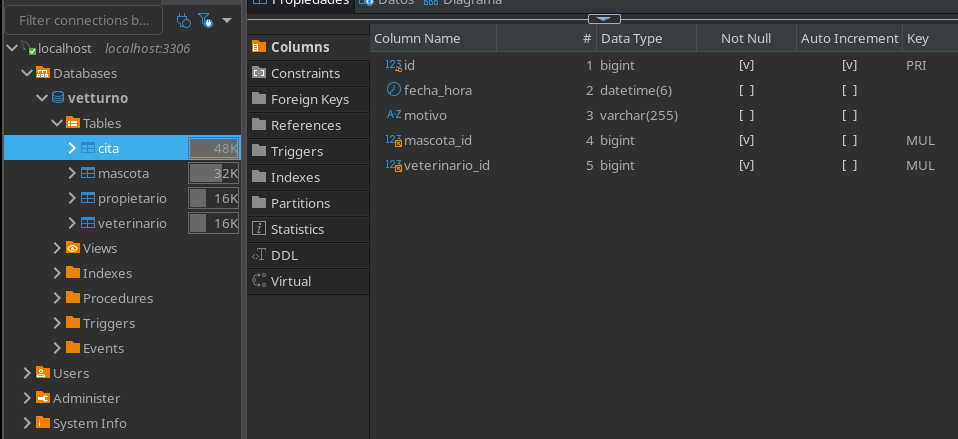
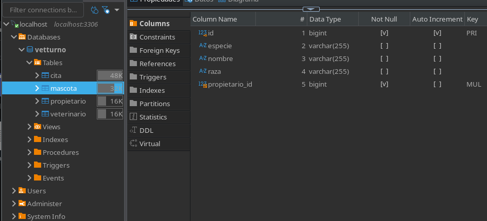
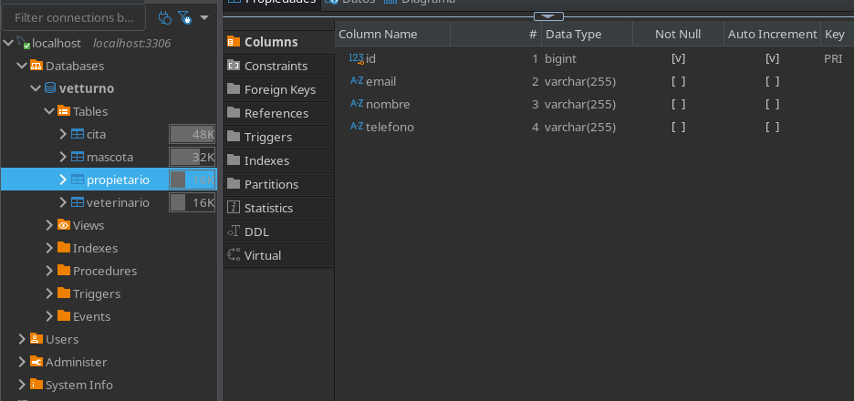
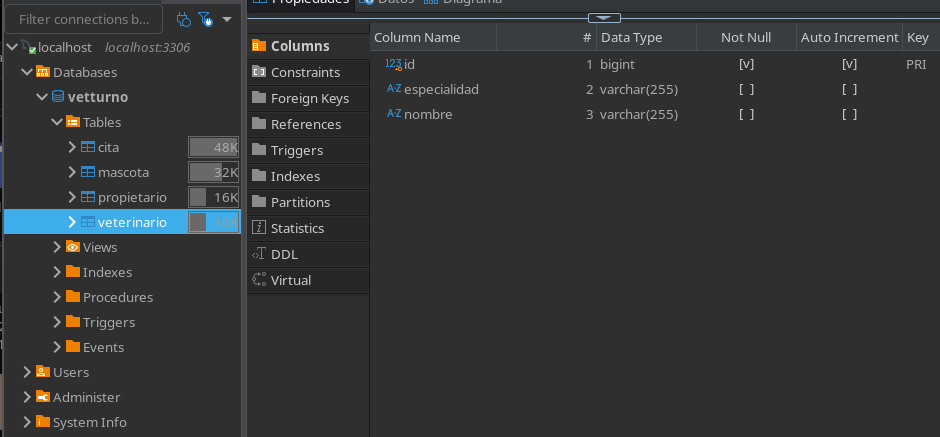
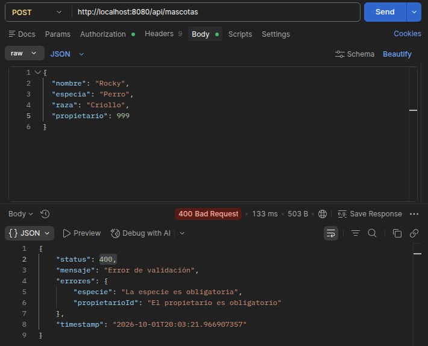
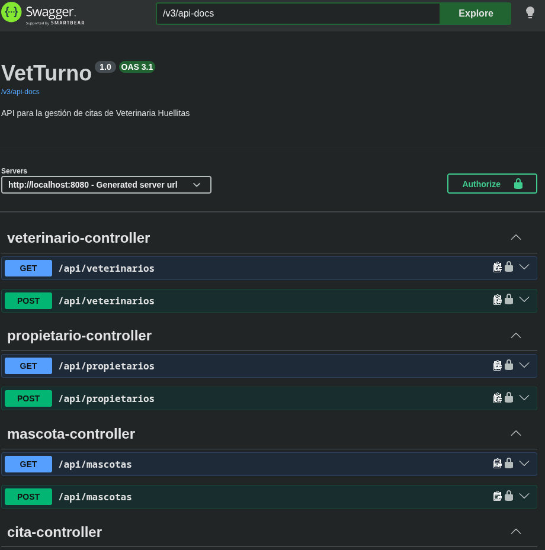
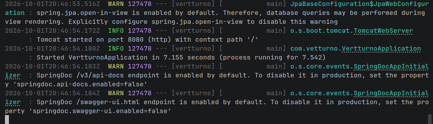

# VetTurno

API REST desarrollada con Spring Boot para gestionar las citas de la veterinaria **Huellitas**.

El sistema permite registrar propietarios, mascotas, veterinarios y citas, además de manejar autenticación mediante JWT y permisos según los roles `USER` y `ADMIN`.

---

## Tecnologías

- Java 17
- Spring Boot
- Spring Web
- Spring Data JPA
- Spring Security
- Hibernate
- MySQL
- JWT
- Bean Validation
- Swagger / OpenAPI
- Maven
- Postman
- Git / GitHub

---

## Arquitectura del proyecto

El proyecto está organizado por capas:

```text
src/main/java/com/vetturno
│
├── config
│   ├── SecurityConfig.java
│   └── OpenApiConfig.java
│
├── controller
│   ├── AuthController.java
│   ├── PropietarioController.java
│   ├── MascotaController.java
│   ├── VeterinarioController.java
│   └── CitaController.java
│
├── dto
│   ├── PropietarioRequest.java
│   ├── PropietarioDTO.java
│   ├── MascotaRequest.java
│   ├── MascotaDTO.java
│   ├── VeterinarioRequest.java
│   ├── VeterinarioDTO.java
│   ├── CitaRequest.java
│   ├── CitaDTO.java
│   ├── RegistroRequest.java
│   ├── LoginRequest.java
│   └── AuthResponse.java
│
├── exception
│   ├── ApiError.java
│   └── GlobalExceptionHandler.java
│
├── model
│   ├── Propietario.java
│   ├── Mascota.java
│   ├── Veterinario.java
│   ├── Cita.java
│   ├── Usuario.java
│   └── Rol.java
│
├── repository
│
├── security
│   ├── JwtService.java
│   ├── JwtAuthFilter.java
│   └── UsuarioDetailsService.java
│
└── service
```

El flujo principal de la aplicación es:

```text
Cliente
   ↓
Controller
   ↓
Service
   ↓
Repository
   ↓
MySQL
```

Los DTO se utilizan para evitar exponer directamente las entidades de persistencia.

---

## Modelo de datos

### Propietario

- id
- nombre
- telefono
- email

### Mascota

- id
- nombre
- especie
- raza
- propietario

Relación:

```text
Muchos Mascotas → Un Propietario
```

### Veterinario

- id
- nombre
- especialidad

### Cita

- id
- fechaHora
- motivo
- mascota
- veterinario

Relaciones:

```text
Muchas Citas → Una Mascota
Muchas Citas → Un Veterinario
```

### Usuario

- id
- email
- password
- rol

Roles disponibles:

```text
USER
ADMIN
```

---

## Base de datos

La aplicación utiliza MySQL.

Crear primero la base de datos:

```sql
CREATE DATABASE vetturno;
```

La configuración principal se encuentra en:

```text
src/main/resources/application.properties
```

La contraseña de MySQL y el secreto JWT no se almacenan directamente en el repositorio.

Se utilizan variables de entorno:

```bash
export DB_PASSWORD='TU_PASSWORD_MYSQL'
export JWT_SECRET='TU_SECRETO_JWT'
```

---

## Ejecutar el proyecto

Desde la raíz del proyecto:

```bash
export DB_PASSWORD='TU_PASSWORD_MYSQL'
export JWT_SECRET='TU_SECRETO_JWT'
./mvnw spring-boot:run
```

Cuando la aplicación inicia correctamente estará disponible en:

```text
http://localhost:8080
```

---

# Autenticación y seguridad

VetTurno utiliza autenticación mediante JWT.

Las contraseñas de los usuarios se almacenan utilizando BCrypt.

La aplicación trabaja sin sesiones utilizando:

```text
SessionCreationPolicy.STATELESS
```

El token se envía mediante el encabezado:

```text
Authorization: Bearer TOKEN
```

---

## Roles

### USER

Puede:

- consultar y registrar propietarios;
- consultar y registrar mascotas;
- consultar veterinarios;
- consultar y registrar citas.

No puede registrar veterinarios.

### ADMIN

Puede realizar las operaciones de `USER` y adicionalmente:

- registrar veterinarios.

---

## Usuario inicial ADMIN

Los usuarios creados mediante:

```text
POST /api/auth/register
```

son registrados inicialmente con rol:

```text
USER
```

Para habilitar el primer administrador se puede actualizar el rol directamente en la base de datos:

```sql
UPDATE usuarios
SET rol = 'ADMIN'
WHERE email = 'correo_del_administrador';
```

Después del cambio el usuario debe iniciar sesión nuevamente para obtener un JWT con el rol actualizado.

---

# Endpoints

## Autenticación

### Registrar usuario

```text
POST /api/auth/register
```

Ejemplo:

```json
{
  "email": "usuario@correo.com",
  "password": "Password123"
}
```

El registro crea usuarios con rol `USER`.

---

### Iniciar sesión

```text
POST /api/auth/login
```

Ejemplo:

```json
{
  "email": "usuario@correo.com",
  "password": "Password123"
}
```

Respuesta:

```json
{
  "token": "JWT"
}
```

---

# Propietarios

### Registrar propietario

```text
POST /api/propietarios
```

Roles:

```text
USER
ADMIN
```

Ejemplo:

```json
{
  "nombre": "Laura Martinez",
  "telefono": "3105551234",
  "email": "laura@example.com"
}
```

Respuesta esperada:

```text
201 Created
```

### Listar propietarios

```text
GET /api/propietarios
```

Respuesta esperada:

```text
200 OK
```

---

# Mascotas

### Registrar mascota

```text
POST /api/mascotas
```

Ejemplo:

```json
{
  "nombre": "Luna",
  "especie": "Perro",
  "raza": "Labrador",
  "propietarioId": 1
}
```

Respuesta esperada:

```text
201 Created
```

### Listar mascotas

```text
GET /api/mascotas
```

Respuesta esperada:

```text
200 OK
```

---

# Veterinarios

### Registrar veterinario

```text
POST /api/veterinarios
```

Solo puede realizarlo:

```text
ADMIN
```

Ejemplo:

```json
{
  "nombre": "Laura Ramirez",
  "especialidad": "Dermatologia"
}
```

Un usuario con rol `USER` recibe:

```text
403 Forbidden
```

Un usuario `ADMIN` recibe:

```text
201 Created
```

### Listar veterinarios

```text
GET /api/veterinarios
```

Disponible para:

```text
USER
ADMIN
```

---

# Citas

### Registrar cita

```text
POST /api/citas
```

Ejemplo:

```json
{
  "fechaHora": "2026-10-05T10:00:00",
  "motivo": "Consulta general",
  "mascotaId": 1,
  "veterinarioId": 1
}
```

Para crear una cita:

- la mascota debe existir;
- el veterinario debe existir;
- la fecha debe ser futura;
- el veterinario no puede tener otra cita en la misma fecha y hora.

Respuesta correcta:

```text
201 Created
```

---

### Listar citas

```text
GET /api/citas
```

Respuesta:

```text
200 OK
```

---

### Consultar citas por veterinario

```text
GET /api/citas/veterinario/{id}
```

Ejemplo:

```text
GET /api/citas/veterinario/1
```

---

# Validaciones

Se utiliza Bean Validation para validar los datos enviados a la API.

Algunas validaciones implementadas son:

- campos obligatorios;
- formato correcto de email;
- contraseña mínima de 8 caracteres;
- IDs obligatorios;
- fecha de cita futura.

Ejemplo de respuesta de validación:

```json
{
  "status": 400,
  "mensaje": "Error de validación",
  "errores": {
    "email": "El email debe tener un formato válido"
  },
  "timestamp": "2026-10-01T20:00:00"
}
```

---

# Manejo global de errores

La API utiliza un manejador global de excepciones.

La estructura de los errores es:

```text
status
mensaje
errores
timestamp
```

Respuestas principales:

```text
200 OK
201 Created
400 Bad Request
403 Forbidden
500 Internal Server Error
```

Los errores internos no muestran información sensible al cliente.

---

# Swagger / OpenAPI

La documentación de la API está disponible en:

```text
http://localhost:8080/swagger-ui/index.html
```

La especificación OpenAPI está disponible en:

```text
http://localhost:8080/v3/api-docs
```

Swagger utiliza autenticación JWT mediante el esquema:

```text
bearerAuth
```

Para probar una ruta protegida:

1. realizar login en `/api/auth/login`;
2. copiar el JWT;
3. presionar `Authorize` en Swagger;
4. pegar el token;
5. ejecutar el endpoint protegido.

---

# Pruebas realizadas

Se ejecutó la matriz de pruebas manuales requerida para el proyecto.

| # | Prueba | Resultado |
|---|---|---|
| 1 | Iniciar aplicación con MySQL disponible | Correcto |
| 2 | Registro válido de usuario | 200 + JWT |
| 3 | Registro con email inválido y contraseña corta | 400 |
| 4 | Login con credenciales válidas | 200 + JWT |
| 5 | Consultar `/api/citas` sin token | Acceso rechazado |
| 6 | Registrar veterinario con USER | 403 |
| 7 | Registrar veterinario con ADMIN | 201 |
| 8 | Registrar propietario válido | 201 |
| 9 | Registrar mascota con propietario existente | 201 |
| 10 | Registrar mascota con propietario inexistente | 400 |
| 11 | Registrar cita futura con referencias válidas | 201 |
| 12 | Registrar cita con fecha pasada | 400 |
| 13 | Registrar segunda cita para el mismo veterinario y horario | 400 |
| 14 | Consultar citas por veterinario | 200 |
| 15 | Reiniciar aplicación y probar Swagger con JWT | Correcto |

Después de reiniciar la aplicación los datos continuaron almacenados en MySQL.

También se verificó desde Swagger que un JWT válido permite consultar:

```text
GET /api/citas
```

obteniendo:

```text
200 OK
```

---

# Persistencia

La información se almacena en MySQL mediante Spring Data JPA y Hibernate.

Se comprobó que los registros permanecen almacenados después de detener y volver a iniciar la aplicación.

---

# Evidencias

Durante el desarrollo se tomaron evidencias de:

# Evidencias

A continuación se presentan las evidencias principales del funcionamiento de VetTurno.

## Base de datos

### Tabla cita

Estructura de la tabla `cita` en MySQL.



### Tabla mascota

Estructura de la tabla `mascota` y su relación con propietario.



### Tabla propietario

Estructura de la tabla `propietario`.



### Tabla veterinario

Estructura de la tabla `veterinario`.



## Validaciones

Respuesta `400 Bad Request` generada por Bean Validation cuando la solicitud contiene datos inválidos.



## Swagger / OpenAPI

Swagger UI mostrando la documentación de VetTurno y el botón `Authorize` para autenticación mediante JWT.



## Ejecución del proyecto

Ejecución de VetTurno siguiendo las instrucciones del README, mostrando el inicio correcto de Spring Boot.



Capturas almacenadas en:

```text
docs/evidencias/
```

---

